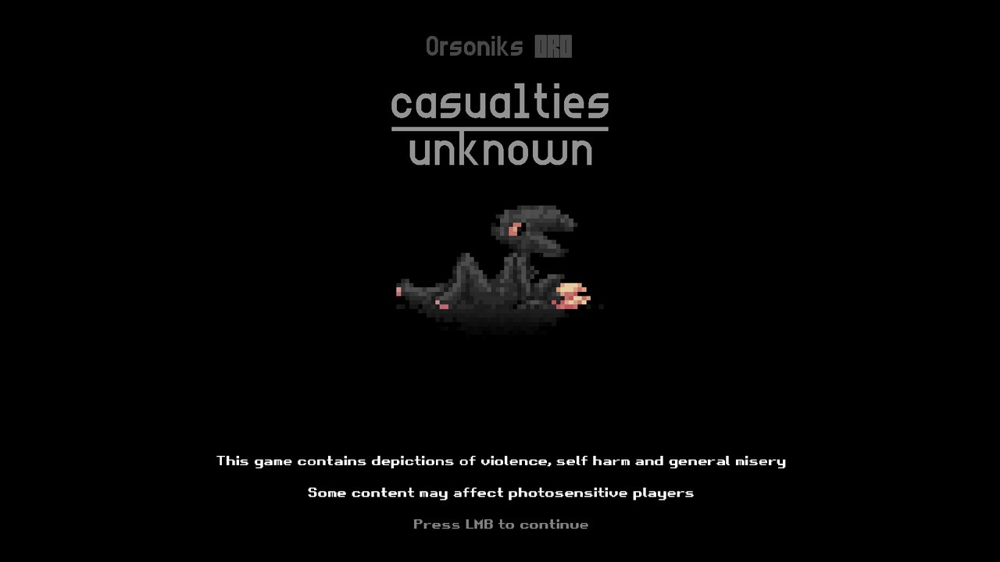
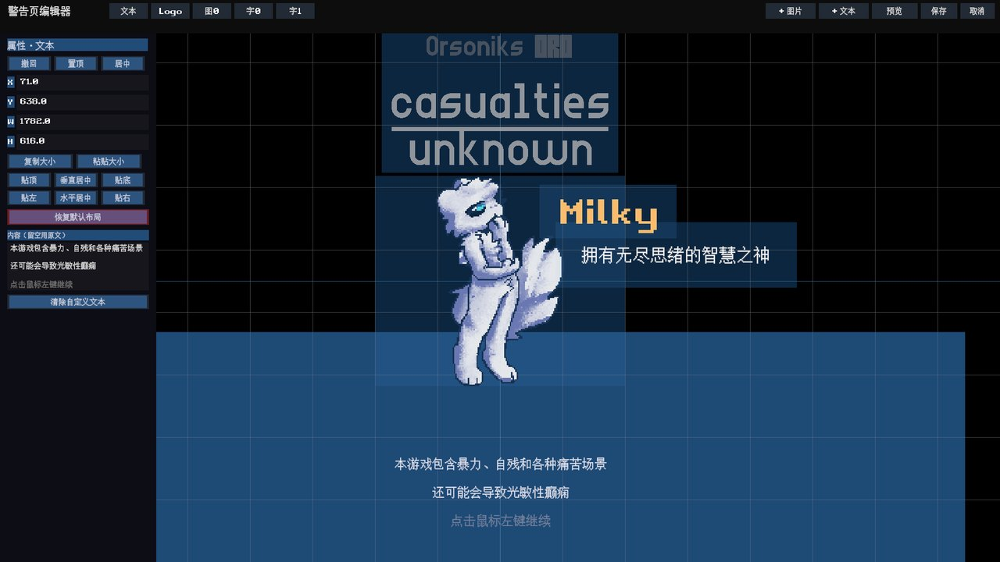
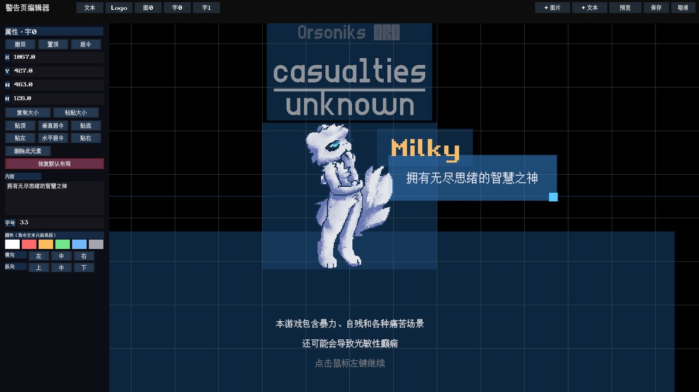
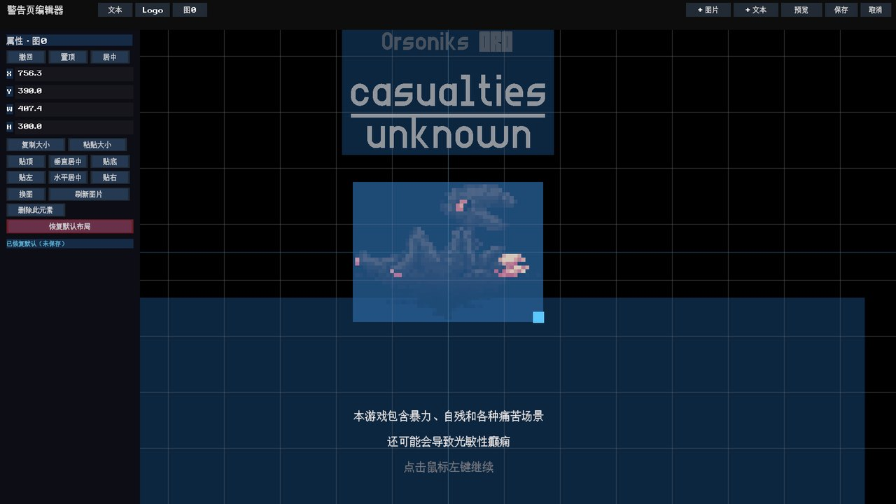
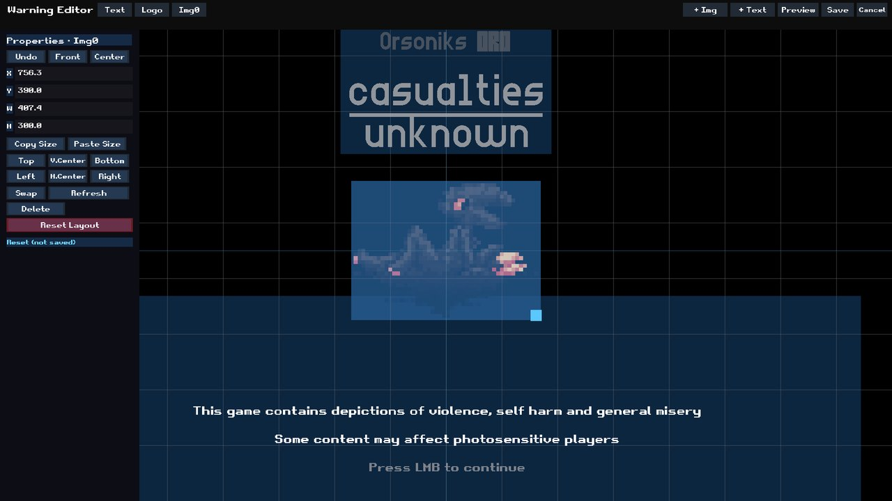
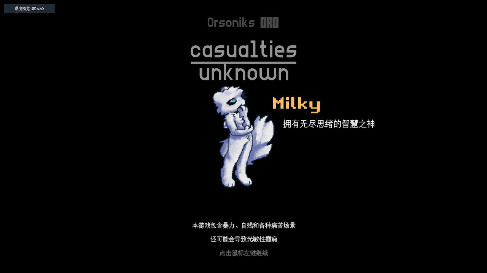
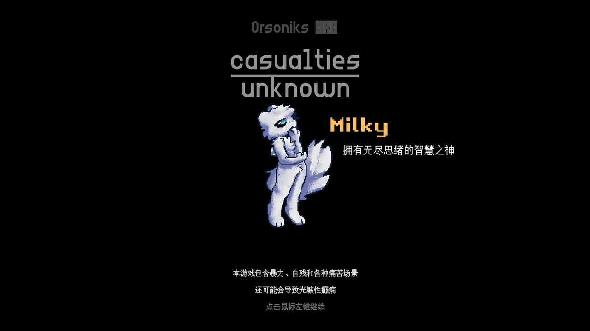

<div align="center">

# Warning Editor

**把 Experiment 带回警告页，顺便重新排一遍。**

[](LICENSE)
[](https://github.com/BepInEx/BepInEx)
[](#)
[](https://github.com/HOPE-LGNF/WarningEditor/releases)
[](https://www.nexusmods.com/scavprototype/mods/973)

[**GitHub 下载**](https://github.com/HOPE-LGNF/WarningEditor/releases) · [**Nexus Mods**](https://www.nexusmods.com/scavprototype/mods/973) · [预览](#预览--preview) · [安装](#安装--install) · [使用](#使用--usage) · [构建](#构建--build)

</div>

> 劳Expie你终于能回来力（喜）



**English TL;DR** — A BepInEx mod for *Casualties Unknown* that turns the startup content-warning screen into a canvas. Add images, add text, drag and resize everything, with a live in-game editor. Open `Settings → Game → Warning Layout → Open Editor`. Nothing is written to disk until you press **Save**.

---

## 特性 / Features

| | |
|---|---|
| 🖼 **图片元素** | 内置 7 张预设，也可以放任意自定义图片 |
| ✍️ **文本框** | 原生字体，支持整段或**选中选段**染色，横向/纵向对齐 |
| 🖱 **所见即所得** | 拖拽移动、右下角缩放、方向键 1px 微调、对齐参考线 |
| 🧭 **对齐工具** | 贴顶/贴底/贴左/贴右/水平居中/垂直居中，一键吸附 |
| ↩️ **撤回** | `Ctrl+Z`，保留最近 40 步 |
| 💾 **保存确认** | `Esc` / 取消 会询问是否保存；恢复默认不会偷偷写盘 |
| 🌐 **中/英界面** | 跟随游戏语言自动切换 |
| 📝 **可改原文** | 警告文本也能改；留空则跟随游戏语言 |

---

## 预览 / Preview

| | |
|:---:|:---:|
| <br>**编辑器**：顶部管理元素，左侧改属性 | <br>**文本框**：内容、字号、颜色、横纵对齐 |
| <br>**图片元素**：换图、刷新、对齐、复制尺寸 | <br>**英文界面**：跟随游戏语言切换 |



*预览模式：隐藏所有编辑控件，只看最终效果（`Esc` 退出）。*



*自定义示例：换成自己的角色图 + 文本，警告原文仍可保留。*

---

## 安装 / Install

需要 [BepInEx 5](https://github.com/BepInEx/BepInEx)（x64）。

把 Release 里的压缩包解压到游戏根目录，合并 `BepInEx` 文件夹即可：

```
Casualties Unknown/
└── BepInEx/
    ├── plugins/
    │   └── Warning Editor/
    │       ├── WarningEditor.dll
    │       └── images/          ← 预设图 + 你自己的图
    └── config/
        └── com.hope.cu.warningeditor.cfg   (首次运行自动生成)
```

---

## 使用 / Usage

主菜单 → **设置** → **游戏** → 最下面「警告页布局」→ **打开编辑器**

| 操作 | 效果 |
|---|---|
| 拖动元素 | 移动 |
| 拖右下角方块 | 缩放（左上角固定） |
| `↑` `↓` `←` `→` | 移动 1px |
| `Shift` + 方向键 | 移动 10px |
| `Tab` / `Shift+Tab` | 切换元素 |
| `Ctrl+Z` | 撤回 |
| `Esc` | 退出预览 / 取消（会询问是否保存） |

顶部「保存」才会写入配置，其余操作都只改内存。

---

## 自定义图片 / Custom images

把 `.png` / `.jpg` 放进 `BepInEx/plugins/Warning Editor/images/`，在编辑器里选中图片元素：

- **换图**：循环切换文件夹里的图片
- **刷新图片**：重新扫描文件夹（新放的图不用重启）

建议用透明背景 PNG；插件会按原始宽高比显示，并使用点采样（像素风不会糊）。

---

## 配置 / Config

`BepInEx/config/com.hope.cu.warningeditor.cfg`

```ini
[General]
Enabled = true

[Elements]
Count = 1

[Element0]
Image = warning_experiment.png
X = 0
Y = -390
W = 407.4
H = 300

[TextBoxes]
Count = 0

[Text]
X = 0
Y = -313
W = 1782
H = 616
Override =        ; 留空 = 跟随游戏语言

[Logo]
X = 0
Y = 883.9
W = 453.6
H = 272.2
```

`Text` / `Logo` 的锚点由场景固定（中心 / 底部中心）；图片与文本框的锚点是顶部中心，`Y` 为负值向下。

---

## 关于游戏原文 / Original warning text

内容框默认显示的是**游戏当前语言**下的 `other.discretionwarning`。
只有你改动它才会写入 `[Text] Override`；点「清除自定义文本」即可恢复跟随游戏语言。

---

## 构建 / Build

```bash
# Windows
dotnet build -c Release -p:GameDir="<你的游戏目录>"

# Linux / WSL
dotnet build -c Release -p:GameDir="/path/to/Casualties Unknown"
```

输出在 `bin/Release/net461/WarningEditor.dll`。

---

## 实现 / How it works

- `PreRunScript.Start` Postfix：应用布局、创建图片/文本元素
- `SettingsMenu.SelectTab(Game)` Postfix：在游戏设置列表底部插入入口
- 编辑器使用独立高排序 Canvas；按钮用矩形命中手动处理，不依赖 uGUI 射线层级
- 文字颜色以「纯文本 + 颜色区间」保存，渲染时才拼 `<color>` 标签，不会切坏标签
- 撤回基于配置快照（位置/尺寸/图片/文本/颜色）

---

## 素材与版权 / Assets

默认的 Experiment 图案取自 **Demo 构建**的 `splashlogo`（正式版没有这张图），仅保留实验体，以嵌入资源形式打包。

`Assets/` 与 `images/` 下的游戏素材**不在 MIT 范围内**，版权归原作所有，详见 [ASSETS-NOTICE.md](ASSETS-NOTICE.md)。

---

## License

代码以 **MIT** 发布 © 2026 HOPE-LGNF。

Code is MIT © 2026 HOPE-LGNF. Game-derived images are **excluded** from the MIT license — see [ASSETS-NOTICE.md](ASSETS-NOTICE.md).
